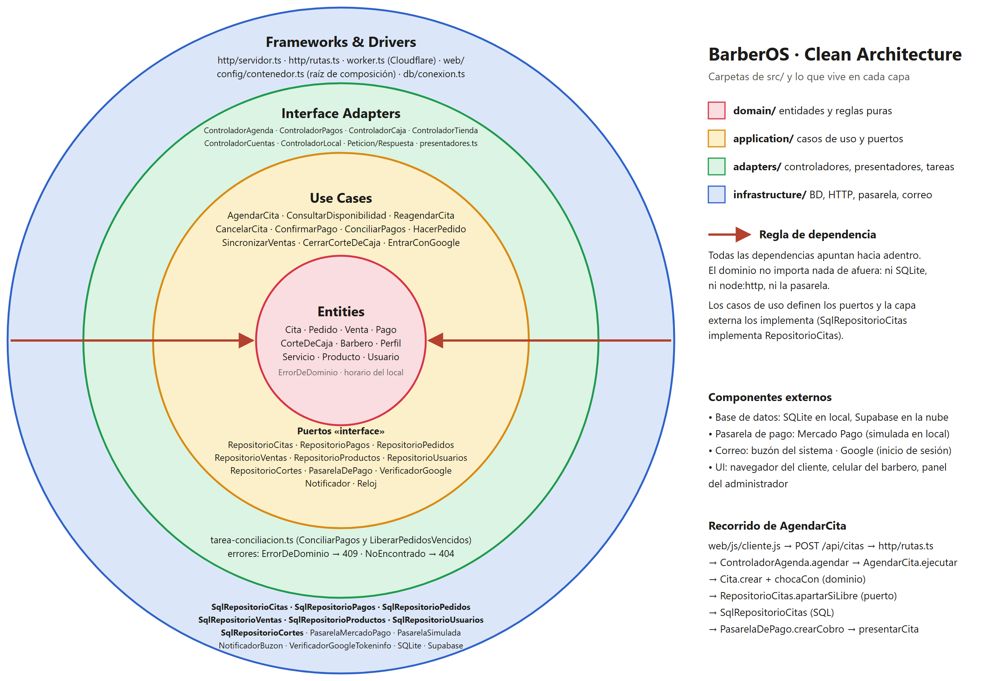

# BarberOS

Sistema de gestión para barberías, adaptable al giro de cada negocio (colores, servicios, precios, productos y barberos se cambian sin tocar código), con tienda de productos. El cliente aparta su cita pagando en línea, el horario nunca se encima, el barbero cobra aunque se caiga el internet y el dueño hace su corte de caja con la comisión de cada barbero.

## Equipo

- Pozas Gomez Fernando — 333414 — Backend y arquitectura
- Juan Pablo Bolaños Rivera — 326570 — Frontend y pruebas
- Julio Alberto Tecuapacho Velázquez — 333364 — Documentación y ADRs 🗣️✊

Materia: Frameworks y Arquitectura de Software (SOF18), UAQ · Profesor: Zabaleta Duran Adrián Rene

## Stack

- **Lenguaje:** TypeScript, corrido directo por Node.js 24 (sin compilar). Única dependencia: `postgres` (el driver para Supabase); `wrangler` para publicar.
- **Servidor web:** `node:http` (sin framework) en la laptop; **Cloudflare Workers** en la nube ([ADR-009](docs/adr/0009-cloudflare-workers-y-supabase-en-la-nube.md)).
- **Base de datos:** SQLite integrado en Node (`node:sqlite`) en la laptop ([ADR-007](docs/adr/0007-sqlite-y-adaptadores-simulados-en-local.md)); **PostgreSQL de Supabase** en la nube.
- **Interfaz:** HTML, CSS y JavaScript sin framework, en `web/`.
- **Pasarela de pago:** Mercado Pago en la versión publicada; simulada en local, detrás del mismo puerto `PasarelaDePago`.
- **Inicio de sesión:** correo y contraseña, o Google ([ADR-011](docs/adr/0011-entrar-con-google.md)).
- **Correo:** buzón del sistema detrás del puerto `Notificador`.
- **Pruebas:** `node:test`.

## Arquitectura

Las dependencias apuntan hacia adentro. Cada capa es una carpeta de `src/`:

| Capa | Carpeta | Qué vive ahí |
|---|---|---|
| Entities / Domain | `src/domain/` | `Cita`, `Venta`, `Pago`, `CorteDeCaja`, `Barbero`, `Servicio`, `Producto` y las reglas puras (horario del local, choque de citas, anticipo del 40 %, cancelar con 2 h). No importa nada de afuera. |
| Use Cases | `src/application/use-cases/` | `AgendarCita`, `ConsultarDisponibilidad`, `CancelarCita`, `ConfirmarPago`, `ConciliarPagos`, `SincronizarVentas`, `GenerarCorteDeCaja`, `CerrarCorteDeCaja`, entre otros. |
| Puertos (interfaces) | `src/application/ports/` | `RepositorioCitas`, `RepositorioPagos`, `RepositorioVentas`, `RepositorioProductos`, `RepositorioCortes`, `PasarelaDePago`, `Notificador`, `Reloj`. |
| Interface Adapters | `src/adapters/` | Controladores (traducen la petición, llaman al caso de uso y no tienen reglas de negocio), presentadores (entidad → JSON) y la tarea de conciliación. |
| Frameworks & Drivers | `src/infrastructure/` | la conexión a la base (SQLite o Supabase) y los repositorios SQL (`SqlRepositorioCitas`…), repositorios en memoria para pruebas, pasarela simulada, buzón de correo, servidor HTTP (`http/servidor.ts` y `src/worker.ts` para Cloudflare) y `config/contenedor.ts`, el único archivo que decide qué implementación va detrás de cada puerto. |

Regla de dependencia: `domain/` no importa nada de las otras carpetas, y `application/` solo importa de `domain/`. Las clases concretas se conectan en `src/infrastructure/config/contenedor.ts`.

## Cómo correrlo

1. Requisitos: **Node.js 22.18 o más nuevo** (probado con 24.14) y `npm install`.
2. `cp .env.example .env` (en Windows: `copy .env.example .env`). Es opcional: sin `.env` usa SQLite en `data/barberos.db`.
3. `npm start` y abrir <http://localhost:3000>.
4. Pruebas: `npm test` (33 pruebas: entidad `Cita`, cuentas, agenda, pagos, caja, tienda y operación del local, con repositorios en memoria).
5. Cuentas del personal: el registro de la página solo crea **clientes**. Barberos y administrador se dan de alta con
   `node scripts/crear-usuario.ts admin <correo> "<nombre>"` o `node scripts/crear-usuario.ts barbero <correo> "<nombre>" barbero-1`
   (imprime una contraseña al azar). Con `--nube` al final se crean en Supabase.

Para empezar con la base de datos vacía: detener el servidor y correr `npm run reiniciar-bd`.

### Publicarlo en la nube (Cloudflare + Supabase)

1. En [Supabase](https://supabase.com) crear un proyecto. En **Connect → Transaction pooler** copiar la cadena de conexión (puerto 6543) y pegarla en `.env` como `DATABASE_URL=...`.
2. `npm run supabase:preparar`: crea las tablas y carga el catálogo de ejemplo. Se puede correr otra vez sin borrar nada.
3. (Opcional) `npm start`: con `DATABASE_URL` en `.env`, la versión local ya usa Supabase.
4. `npx wrangler login` (una vez), luego `npx wrangler secret put DATABASE_URL` y pegar la misma cadena.
5. "Acceder con Google": el ID de cliente (público) va en `wrangler.jsonc` → `vars.GOOGLE_CLIENT_ID` y en `.env` para la laptop. Sin él no aparece el botón.
6. Para cobrar de verdad: `npx wrangler secret put MP_ACCESS_TOKEN` con el Access Token de Mercado Pago. Sin él, la versión publicada usa la pasarela simulada.
7. `npm run deploy`. Wrangler imprime el link público `https://barberos.<tu-subdominio>.workers.dev`.

### Recorrido de la demo

1. **Cliente** (`#cliente`): elegir servicio, barbero, día y hora → *Entrar para apartar*. Se crea la cuenta (nombre, correo y contraseña) y regresa con todo lo que había elegido. *Apartar y pagar* aparta el horario 10 minutos.
2. *Ir a pagar*: en la laptop abre la pasarela simulada (*Pagar* manda el webhook; *Pagar, pero simular que el webhook se pierde* deja el pago para la conciliación). En la versión publicada abre **Mercado Pago** (solo tarjeta o saldo); al pagar, el webhook confirma la cita y el cliente regresa solo. Abajo aparece **Mis citas**.
3. **Barbero** (`#barbero`, entra con su cuenta y solo ve su silla): elegir el día de la cita. Apagar *Con internet*, cobrar la cita y agregar un producto: la venta queda en la cola del navegador con su propio id. Encender el internet: la cola se sube sola y no se duplica aunque se reenvíe.
4. **Administrador**, pestaña *Caja* (`#admin`, solo con cuenta de admin): mientras la venta no se suba, el corte de ese día aparece bloqueado. Ya subida, muestra efectivo, tarjeta, en línea (citas y tienda), el desglose servicios/productos y la comisión de cada barbero. Al cerrar se escribe el efectivo contado y el sistema dice si cuadra. Ahí mismo está el buzón con los correos que mandó el sistema.
5. **Tienda** (`#tienda`): cualquiera ve los productos; para pedir se entra con cuenta. Recoger en la barbería o envío a domicilio. Las piezas quedan apartadas 10 minutos mientras se paga; si no se paga, regresan solas al inventario. Al agendar, el paso *¿Algo más?* ofrece 3 recomendados que se pagan en el mismo cobro de la cita.
6. **Administrador**, pestaña *Local* (`#local`): pedidos por surtir (listo → entregado, con correo al cliente), devoluciones pendientes, cliente sin cita, bloquear un rato a un barbero o marcarlo ausente (sus citas pasan a otro o se cancelan avisando), y el catálogo (precios, piezas, comisiones, barberos).

## Documentación

- ADRs: [`docs/adr/`](docs/adr/) (ADR-008 reemplaza una parte de ADR-002; ADR-009 explica la versión en la nube; ADR-010, las cuentas y Mercado Pago; ADR-011, entrar con Google; ADR-012, la tienda en línea).
- Trazabilidad de las reglas de negocio y los casos de uso: [`docs/requerimientos.md`](docs/requerimientos.md).
- Demo en línea: https://barberos.barberos-uaq.workers.dev
- Diagrama: [`docs/arquitectura.png`](docs/arquitectura.png) (también en SVG).
- Video: https://drive.google.com/file/d/1uYuffE2KLzN1gKvfZIi-VKszJhS33b94/view?usp=sharing

## Imágenes

Las fotografías de la página (local, barberos, servicios y productos, en `web/img/`) fueron **generadas con
inteligencia artificial y son de carácter ilustrativo**. La Esquina es una barbería ficticia: cada barbería que
use BarberOS puede cambiarlas por las suyas según su giro, sin tocar el código (se reemplazan los archivos con el
mismo nombre). Los logotipos de tarjetas, bancos y Mercado Pago pertenecen a sus respectivas marcas.
